# Bookify

> **Read more, stress less.**

Bookify es una aplicación para iPhone, hecha con SwiftUI, que sirve para descubrir libros, explorarlos por categoría, buscar en todo el catálogo de [Open Library](https://openlibrary.org) y guardar hasta 10 favoritos en el dispositivo.

Proyecto integrador de la materia **Desarrollo de aplicaciones para dispositivos iOS**, Facultad de Contaduría y Administración, UNAM.

---

## Índice

1. [Funcionalidades](#1-funcionalidades)
2. [Tecnologías](#2-tecnologías)
3. [Requisitos](#3-requisitos)
4. [Instalación y configuración](#4-instalación-y-configuración)
5. [Ejecución](#5-ejecución)
6. [Servicio externo: Open Library](#6-servicio-externo-open-library)
7. [Arquitectura](#7-arquitectura)
8. [Networking](#8-networking)
9. [Persistencia](#9-persistencia)
10. [Decisiones técnicas](#10-decisiones-técnicas)
11. [Pruebas unitarias](#11-pruebas-unitarias)
12. [Limitaciones conocidas](#12-limitaciones-conocidas)
13. [Integrantes](#13-integrantes)

---

## 1. Funcionalidades

Funcionalidades implementadas en la versión final:

| # | Funcionalidad | Detalle |
|---|---|---|
| 1 | **Pantalla de inicio** | Logo, lema y botón **Start Reading** que lleva al catálogo (no pide correo ni contraseña). |
| 2 | **Catálogo** | Carrusel **Discover more...** con las tendencias del día y un carrusel por cada categoría (Fantasy, Science Fiction, Mystery, Romance, Horror, Biography, Children, History). Cada carrusel tiene sus propios estados de carga, vacío y error, con botón **Retry**. |
| 3 | **Menú de categorías** | El botón de hamburguesa despliega la lista de categorías; al elegir una, el catálogo baja hasta su carrusel. |
| 4 | **Búsqueda en la API** | Busca en todo Open Library mientras el usuario escribe, esperando 0.5 s después de la última letra. Muestra cargando, sin resultados, error o la lista de resultados. Tocar un resultado abre el detalle. |
| 5 | **Detalle del libro** | Portada, título, páginas, calificación promedio, autor, año de publicación, categoría, idioma y **Summary**: la descripción del libro; si no la hay, su primera frase; si tampoco, *No summary available*. |
| 6 | **Favoritos** | Se marcan desde el detalle con el botón de marcador. Pestaña propia con vista en **cuadrícula o lista**; la app recuerda la vista elegida. Límite de **10 libros**: al intentar agregar el 11.º aparece el aviso *Favorites limit reached*. |
| 7 | **Persistencia** | Los favoritos, con todos los datos del libro, y la preferencia de cuadrícula o lista se conservan al cerrar y volver a abrir la app. |
| 8 | **Configuración** | Tarjetas **Mode** y **Language** (solo muestran la idea, con la etiqueta *Coming soon*) y **About Us**, con la foto del equipo y la descripción de Bookify. |
| 9 | **Barra de pestañas** | Home, Favorites y Settings. |

### Capturas de pantalla

| Inicio | Catálogo | Menú de categorías | Búsqueda |
|:---:|:---:|:---:|:---:|
| 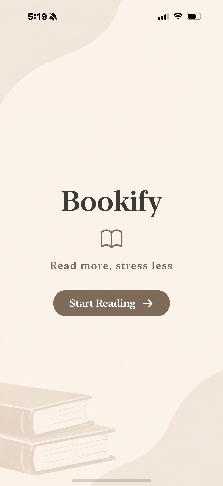 | 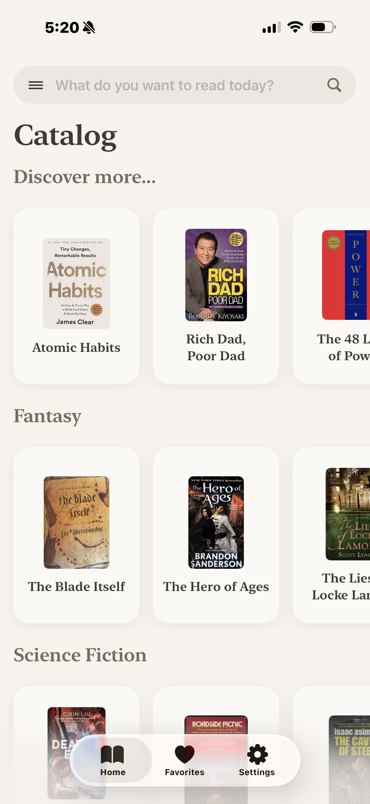 | 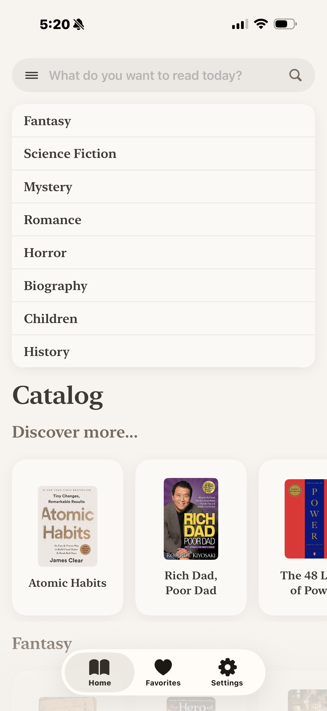 | 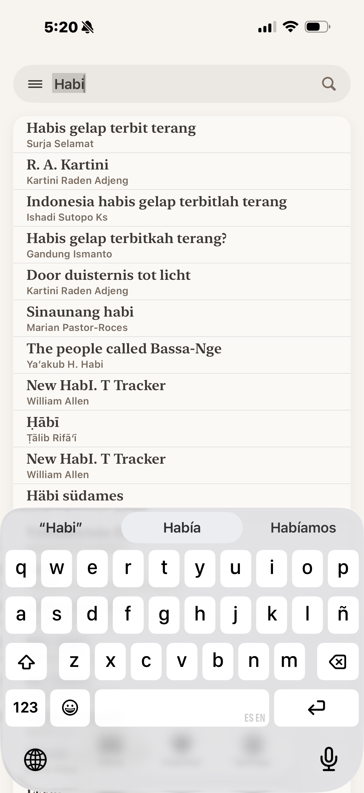 |

| Detalle | Límite de favoritos | Favoritos (cuadrícula) | Favoritos (lista) |
|:---:|:---:|:---:|:---:|
| 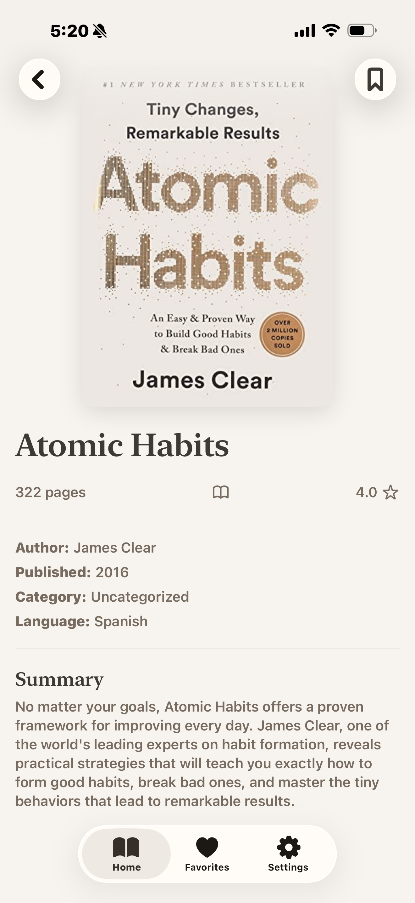 | 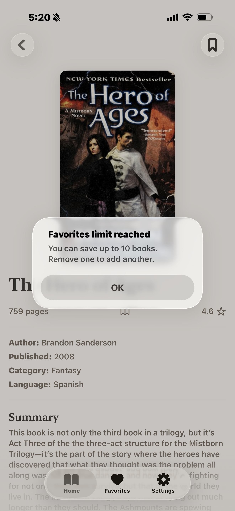 | 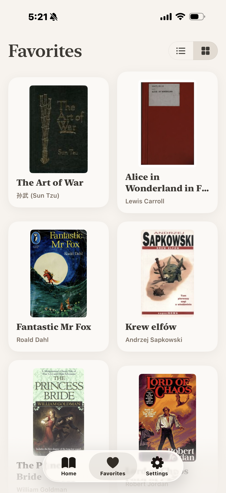 | 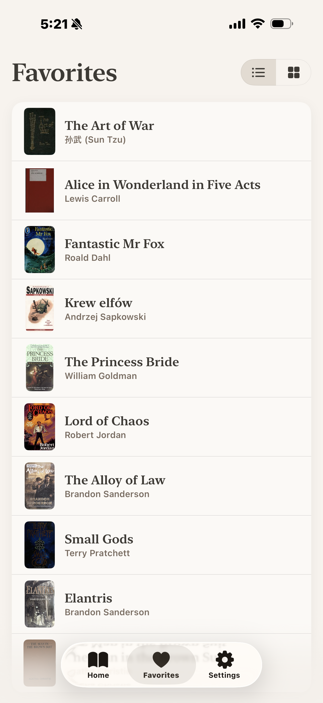 |

| Settings | Mode | Language | About Us |
|:---:|:---:|:---:|:---:|
| 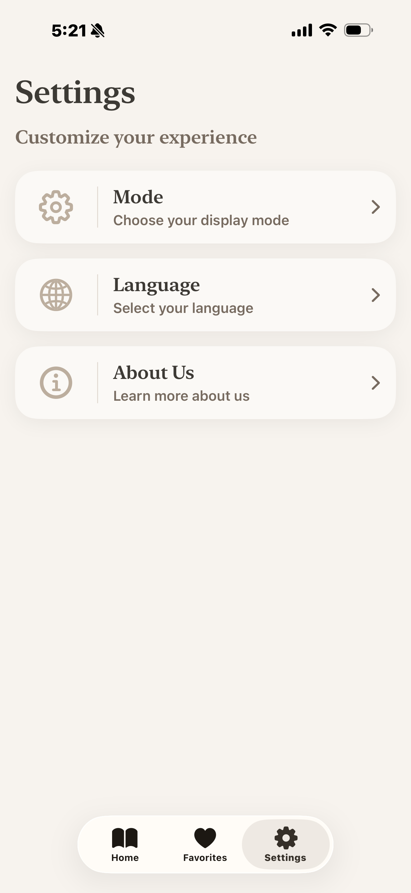 | 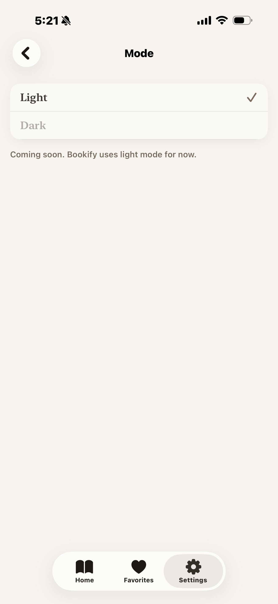 | 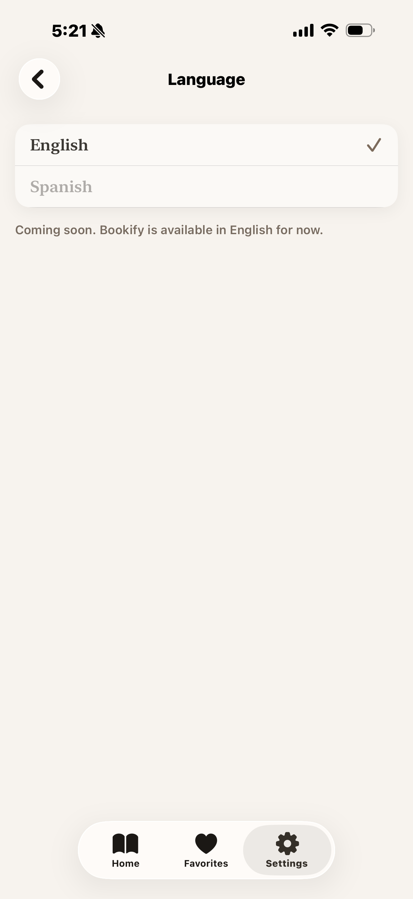 | 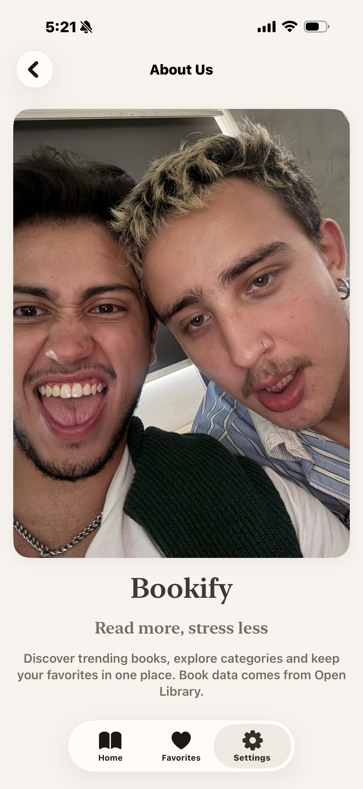 |

---

## 2. Tecnologías

| Tecnología | Uso en el proyecto |
|---|---|
| **Swift** | Lenguaje de la app y de las pruebas. |
| **SwiftUI** | Todas las vistas: `TabView`, `NavigationStack`, `ScrollViewReader`, `AsyncImage`, `LazyVGrid`. |
| **Observation** (`@Observable`) | Estado compartido (`AppState`) y ViewModel del catálogo. |
| **Swift Concurrency** (`async/await`, `Task`) | Peticiones a la API y espera de la búsqueda (`.task(id:)` + `Task.sleep`). |
| **URLSession + Codable** | Cliente HTTP y decodificación del JSON de Open Library. |
| **SwiftData** | Guardado local de los favoritos. |
| **UserDefaults** | Guardado de la preferencia de cuadrícula o lista de Favoritos. |
| **XCTest** | Pruebas unitarias con el patrón Arrange-Act-Assert. |
| **Open Library API** | Fuente de los libros, las portadas y los resúmenes. |
| **Xcode, Git y GitHub** | Desarrollo, control de versiones y Pull Requests. |

No usa dependencias externas (ni CocoaPods ni Swift Package Manager).

---

## 3. Requisitos

| Requisito | Versión |
|---|---|
| macOS | Compatible con Xcode 26 |
| Xcode | **26.6** o posterior (el proyecto se creó con Xcode 26.6) |
| iOS (deployment target) | **26.5** o posterior |
| Dispositivo | Simulador de iPhone o iPhone físico |
| Internet | **Obligatorio** para cargar el catálogo, la búsqueda, las portadas y los resúmenes |
| Cuenta de Apple | Solo para instalar la app en un iPhone físico (una Apple ID gratuita es suficiente) |

---

## 4. Instalación y configuración

1. **Clona el repositorio**, o descarga la rama `main` como ZIP desde **Code → Download ZIP**:

   ```bash
   git clone https://github.com/Shantyyyys/DESARROLLO-DE-APLICACIONES-PARA-DISPOSITIVOS-IOS.git
   cd DESARROLLO-DE-APLICACIONES-PARA-DISPOSITIVOS-IOS
   ```

2. **Abre el proyecto** `Proyecto/Bookify/Bookify.xcodeproj` con Xcode.

3. **Firma (solo para iPhone físico).** En *Bookify* (target) → **Signing & Capabilities**, elige tu propio **Team** y, si Xcode lo pide, cambia el **Bundle Identifier** (por ejemplo, `com.tunombre.Bookify`). En el simulador no hace falta cambiar nada.

No hay que instalar paquetes, crear archivos de configuración ni registrar claves de API (ver [sección 6](#6-servicio-externo-open-library)).

---

## 5. Ejecución

1. En la barra de Xcode, elige el esquema **Bookify** y un simulador de iPhone, o tu iPhone conectado.
2. Ejecuta la app con **⌘R** (Product → Run).
3. En la pantalla de inicio, toca **Start Reading**.

**Flujo principal para probar la app:**

1. **Home:** espera a que carguen *Discover more...* y los carruseles de categorías.
2. Toca el **menú ☰** y elige una categoría; el catálogo baja hasta ella.
3. Escribe en la barra de búsqueda (por ejemplo, *Habits*) y toca un resultado.
4. En el detalle, revisa el **Summary** y toca el **marcador** para guardar el libro.
5. Ve a **Favorites** y cambia entre **lista** y **cuadrícula**.
6. Cierra la app por completo y vuelve a abrirla: los favoritos y la vista elegida se conservan.
7. **Settings:** abre Mode, Language y About Us.

**Pruebas unitarias:** ejecútalas con **⌘U** (Product → Test). No necesitan internet.

---

## 6. Servicio externo: Open Library

Bookify consume la API pública de **[Open Library](https://openlibrary.org/developers/api)** (Internet Archive).

- **No requiere clave de API, token ni registro.** El repositorio no contiene credenciales y no hay nada que configurar.
- La URL base está en `Services/BookService.swift` (`https://openlibrary.org`), y las portadas se piden a `https://covers.openlibrary.org`.
- Todas las peticiones son `GET` por HTTPS, así que no hace falta configurar *App Transport Security*.
- Para que la app funcione, el simulador o el iPhone necesitan conexión a internet.

---

## 7. Arquitectura

La app sigue el patrón **MVVM** con un **estado compartido** (`AppState`), y las dependencias se pasan por **inyección**: cada clase recibe lo que necesita en su `init` en vez de crearlo ella misma.

```
Proyecto/Bookify/
├── Bookify.xcodeproj
├── Bookify/
│   ├── App/          BookifyApp (punto de entrada) y ContentView (inicio ↔ pestañas)
│   ├── Models/       Book, BookDTO, BookCategory, FavoriteBook (@Model de SwiftData)
│   ├── State/        AppState: única fuente de verdad (libros, favoritos, vista de Favoritos)
│   ├── ViewModels/   CatalogoViewModel: carga, búsqueda, categorías y resumen
│   ├── Services/     APIClient, BookService, FavoritesStore, SwiftDataFavoritesStore
│   ├── Views/        LoginView, CatalogoView, BookDetailView, FavoritesView,
│   │                 SettingsView, BookCoverImage, Theme
│   └── Assets.xcassets
├── BookifyTests/     Pruebas unitarias (XCTest)
└── Docs/
    ├── flujos.md     Recorrido paso a paso de los flujos F1–F10
    └── screenshots/  Capturas de la app
```

### Responsabilidades

| Componente | Responsabilidad |
|---|---|
| `BookifyApp` | Crea el `ModelContainer` de SwiftData, el `AppState` y el `CatalogoViewModel`, y los inyecta en `ContentView`. Fuerza el modo claro. |
| `ContentView` | Muestra `LoginView` hasta que se toca *Start Reading* (`isLoggedIn`) y después el `TabView` con Home, Favorites y Settings. |
| `AppState` | Estado compartido por todas las pantallas: libros conocidos, ids favoritos, límite de 10 y preferencia de cuadrícula o lista. Guarda y borra los favoritos a través de `FavoritesStore`. |
| `CatalogoViewModel` | Estados de carga (`loading`, `content`, `empty`, `error`) de tendencias, de cada categoría y de la búsqueda; búsqueda con espera; resumen del detalle. Junta en `AppState` los libros que llegan, sin duplicados. |
| `BookService` | Conoce los endpoints de Open Library: arma las URL y devuelve DTOs. |
| `APIClient` | Cliente HTTP genérico: hace la petición, valida el código de estado y decodifica el JSON. Convierte los fallos en `APIError`. |
| `FavoritesStore` | Protocolo de guardado de favoritos. Tiene dos implementaciones: `SwiftDataFavoritesStore` (la app) e `InMemoryFavoritesStore` (pruebas y previews). |
| `Book` / `BookDTO` | `BookDTO` tiene la misma forma que el JSON de la API (con campos opcionales); `Book` es el modelo listo para mostrar. |
| `BookCategory` | Lista fija de 8 categorías: el término de búsqueda de cada una y la asignación de categoría según los *subjects* del libro. |
| Vistas | Solo muestran el estado y mandan las acciones al ViewModel o a `AppState`. `Theme` define la paleta de colores y `BookCoverImage` es la portada reutilizable. |

### Flujo de datos

```
Vista ──acción──▶ CatalogoViewModel ──▶ BookService ──▶ APIClient ──▶ Open Library
  ▲                     │                                          (JSON → BookDTO)
  │                     ▼
  └──observa──── AppState ◀──▶ FavoritesStore (SwiftData)
```

El código tiene marcas `[F#.#]` que corresponden a los pasos de cada flujo descrito en [`Docs/flujos.md`](Proyecto/Bookify/Docs/flujos.md).

---

## 8. Networking

**API:** Open Library. **Base URL:** `https://openlibrary.org`. Todas las peticiones son `GET` y devuelven JSON.

### Endpoints utilizados

| Uso en la app | Endpoint | Parámetros |
|---|---|---|
| *Discover more...* (tendencias) | `/trending/daily.json` | `limit=20` |
| Completar los datos de las tendencias | `/search.json` | `q=key:("/works/…" OR "/works/…")`, `fields=…` |
| Barra de búsqueda | `/search.json` | `q=<texto>`, `limit=20`, `fields=…` |
| Carrusel de una categoría | `/search.json` | `q=subject:"<categoría>"`, `limit=15`, `fields=…` |
| Resumen del detalle | `/works/{id}.json` | — |
| Portadas | `https://covers.openlibrary.org/b/id/{cover_i}-L.jpg` | — (las carga `AsyncImage`) |

En todas las búsquedas se piden solo los campos que usa la app:
`fields=key,title,author_name,first_publish_year,cover_i,language,number_of_pages_median,subject,first_sentence,ratings_average`

### Modelos de respuesta

```swift
// /search.json
struct BookSearchResponseDTO: Decodable { let docs: [BookDTO] }

// /trending/daily.json
struct TrendingResponseDTO: Decodable { let works: [BookDTO] }

// /works/{id}.json
struct WorkDTO: Decodable { let description: OpenLibraryText? }

struct BookDTO: Decodable {
    let key: String                  // "key"  →  id del libro, ej. "/works/OL45804W"
    let title: String                // "title"
    let authorNames: [String]?       // "author_name"
    let firstPublishYear: Int?       // "first_publish_year"
    let coverId: Int?                // "cover_i"
    let languages: [String]?         // "language"  (códigos ISO 639-2: "spa", "eng")
    let pagesMedian: Int?            // "number_of_pages_median"
    var subjects: [String]?          // "subject"  →  categoría
    var firstSentence: OpenLibraryText?  // "first_sentence"
    var ratingsAverage: Double?      // "ratings_average"
}
```

- `OpenLibraryText` acepta los tres formatos en que la API entrega algunos textos: `"texto"`, `["texto"]` o `{"type": "/type/text", "value": "texto"}`.
- `Book(from:)` convierte el DTO al modelo de la app y pone valores por defecto cuando falta un dato: *Unknown author*, `0` en páginas o calificación (la vista muestra "—"), *Uncategorized*, etc.

### Manejo de errores

`APIClient` lanza un `APIError` con uno de estos casos: `invalidURL`, `connectivity`, `invalidResponse`, `httpError(statusCode:)` o `decodingFailed`. El ViewModel lo convierte en el estado `.error` de la sección correspondiente y la vista muestra el mensaje con el botón **Retry**. Si se cancela una búsqueda porque el usuario siguió escribiendo, no se trata como error.

---

## 9. Persistencia

| Qué se guarda | Mecanismo | Dónde |
|---|---|---|
| **Favoritos**, con todos los datos del libro: id, título, autor, año, categoría, idioma, páginas, calificación, URL de la portada, primera frase y fecha en que se agregó | **SwiftData** (`@Model FavoriteBook`) | `Models/FavoriteBook.swift`, `Services/SwiftDataFavoritesStore.swift` |
| **Vista de Favoritos** (`grid` / `list`) | **UserDefaults**, clave `favoritesLayout` | `State/AppState.swift` |

- Cada vez que se marca un favorito se hace un **insert** de `FavoriteBook`, y al desmarcarlo se hace un **delete**. `bookId` es único (`@Attribute(.unique)`).
- Al abrir la app, `AppState` lee los favoritos guardados y los agrega a la lista de libros. Así la pestaña Favoritos se ve completa sin volver a consultar la API, aunque esos libros ya no aparezcan en las tendencias ni en las categorías.
- `AppState` depende del protocolo `FavoritesStore` y no de SwiftData directamente. En las pruebas se usa `InMemoryFavoritesStore` y un `UserDefaults` aislado.
- El catálogo, las búsquedas y los resúmenes **no se guardan**: se piden a la API cada vez que se abre la app.

---

## 10. Decisiones técnicas

| Decisión | Motivo |
|---|---|
| **MVVM + `AppState` como única fuente de verdad** | Home, Favorites y el detalle comparten los mismos datos: un favorito marcado en una pantalla aparece al instante en las demás. |
| **Inyección de dependencias** (`AppState`, `BookServiceProtocol`, `FavoritesStore`, `UserDefaults`) | Permite probar el ViewModel y el estado con servicios falsos (`MockBookService`, `InMemoryFavoritesStore`), sin internet ni base de datos real. |
| **`APIClient` genérico separado de `BookService`** | El cliente HTTP no sabe de libros y el servicio no sabe de HTTP; cada uno tiene una sola responsabilidad. |
| **Todo sale de `search.json`** (búsqueda y categorías) | Un solo formato de respuesta y un solo DTO. Se descartó `/subjects/{categoría}.json` porque tiene otro formato. |
| **8 categorías fijas** | Open Library no tiene un endpoint con la lista de categorías; la misma lista alimenta el menú y los carruseles. |
| **Tendencias completadas con una segunda consulta** | `/trending/daily.json` no trae páginas, calificación ni *subjects*; se piden en **una sola** consulta a `search.json` por sus claves. Si esa consulta falla, se muestran las tendencias con los datos que tengan. |
| **Búsqueda mientras se escribe con espera de 500 ms** (`.task(id:)` + `Task.sleep`) | Evita mandar una petición por cada letra; SwiftUI cancela la búsqueda anterior cuando cambia el texto. |
| **Estados de carga por sección** | Si falla una categoría, el resto del catálogo sigue funcionando, y cada sección tiene su propio **Retry**. |
| **Favoritos guardados con todos sus datos** (no solo el id) | Para que Favoritos se vea completo al reabrir la app, sin depender de la API. |
| **Límite de 10 favoritos** | Decisión de diseño de la app; se avisa al usuario con una alerta. |
| **UserDefaults para la vista de Favoritos** | Es una preferencia simple; no justifica un modelo de SwiftData. |
| **Modo claro forzado** | El diseño visual (crema y café) solo tiene versión clara; así la app se ve igual aunque el iPhone esté en modo oscuro. |
| **Inicio sin correo ni contraseña** | Así lo pide el diseño final; la app no maneja cuentas de usuario. |
| **Interfaz en inglés; código comentado en español** | La interfaz sigue el diseño; los comentarios y la documentación están en el idioma del equipo. |

---

## 11. Pruebas unitarias

**38 pruebas** con **XCTest** y el patrón **Arrange-Act-Assert**, en `Proyecto/Bookify/BookifyTests/`. No hacen peticiones reales: usan `MockBookService`, `InMemoryFavoritesStore`, un `ModelContainer` en memoria y un `UserDefaults` aislado.

| Archivo | Pruebas | Qué verifica |
|---|:---:|---|
| `AppStateTests` | 11 | Marcar y desmarcar favoritos, límite de 10, recuperar favoritos guardados, recordar la vista de Favoritos. |
| `CatalogoViewModelLoadTests` | 10 | Estados de carga, vacío y error, búsqueda en la API, regla del resumen (descripción → primera frase → aviso). |
| `SwiftDataFavoritesStoreTests` | 6 | Insert, delete y lectura de favoritos con SwiftData en memoria. |
| `BookCategoryTests` | 5 | Asignación de categoría según los *subjects*, *Uncategorized*, término de búsqueda. |
| `CatalogoViewModelTests` | 4 | Lista de libros, filtro de favoritos y búsqueda vacía. |
| `BookMappingTests` | 2 | Conversión de `BookDTO` a `Book` (portada, idioma, valores por defecto). |

`BookFixtures.swift` contiene los libros de ejemplo que comparten las pruebas.

**Cómo ejecutarlas:** abre el proyecto en Xcode y presiona **⌘U**.

---

## 12. Limitaciones conocidas

- **El inicio no autentica.** *Start Reading* solo da paso al catálogo; no hay cuentas de usuario.
- **Mode y Language no funcionan todavía.** Solo muestran la idea (*Coming soon*): la app siempre está en modo claro y en inglés.
- **El endpoint de tendencias** (`/trending/daily.json`) no está documentado oficialmente por Open Library; podría cambiar o dejar de responder.
- **Categoría aproximada.** Se deduce de los *subjects* del libro; si ninguno coincide con las 8 categorías, se muestra *Uncategorized* (por ejemplo, *Atomic Habits*).
- **Idioma.** Open Library lista los idiomas de todas las ediciones de un libro; la app muestra *Spanish* si alguna edición está en español. Por eso un libro escrito originalmente en inglés puede aparecer como *Spanish*.
- **Resultados de búsqueda.** Son los que devuelve Open Library (pueden incluir libros en otros idiomas o con títulos parecidos) y se muestran como máximo 20, sin paginación. Cada categoría muestra hasta 15 libros.
- **Calificación.** Es el promedio de Open Library; el usuario no puede calificar. Si no hay calificación o páginas, se muestra "—".
- **Requiere internet.** Sin conexión, solo funciona la pestaña Favoritos; el catálogo, la búsqueda, las portadas y los resúmenes no se guardan en el dispositivo.
- **Resúmenes.** Se muestran tal como los entrega la API; algunos pueden traer enlaces o formato poco limpio.
- **Favoritos guardados en versiones anteriores** (solo con el id) no se muestran después de la actualización a la versión que guarda todos los datos del libro.
- **Prueba `testBusquedaSinCoincidencias`.** Desde que la búsqueda se hace en la API, esta prueba ya no ejecuta una búsqueda y siempre pasa; la búsqueda real se cubre en `CatalogoViewModelLoadTests` (`testSearchBooksConsultaLaAPI`).
- **Errores en consola.** Los errores de red se registran con `print`; no hay un sistema de *logs*.

---

## 13. Integrantes

- **Santiago Méndez Del Valle**
- **Rodrigo Bretón Nava**
